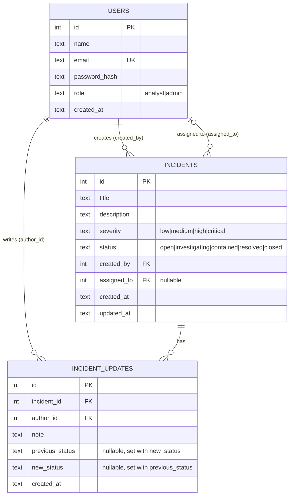

# ERD

One user creates many incidents. One incident has many updates. An incident may be unassigned (`assigned_to` is NULL).

## Design decisions

- **SQLite:** zero setup, easy test database, enough for the data size. Persistence on a host is a separate concern, see the README section "Hosting and data persistence".
- **Status changes keep both sides.** An update row stores `previous_status` and `new_status`, so the history reads as "investigating -> contained", not just "contained". Both columns are NULL for a note-only update and both are set for a status change (CHECK constraint), and they can never be equal.
- **One transaction.** Posting an update with `new_status` inserts the history row and changes `incidents.status` together (`BEGIN IMMEDIATE`). Either both are saved or neither. `previous_status` is read inside the same transaction, so it is always the status that was really replaced.
- **Status is only changed through updates.** `PATCH /api/incidents/:id` cannot set `status`. Result: an incident's status always equals the `new_status` of its latest status-changing update (or `open` if it has none). The allowed moves are defined in the README.
- **Delete cascades.** `incident_updates.incident_id` is `ON DELETE CASCADE`, so deleting an incident removes its history. SQLite only enforces foreign keys when asked, per connection, so `openDb()` runs `PRAGMA foreign_keys = ON` and reads it back; the app refuses to start if it is not on.
- **Authors are protected.** `created_by` and `author_id` are `ON DELETE RESTRICT`, so a user who wrote history cannot be deleted out from under it. `assigned_to` is `ON DELETE SET NULL`.
- **Enums are enforced twice:** Zod at the API edge and CHECK constraints in the database.
- **TEMPORARY, Week 1 only:** `created_by` (incidents) and `author_id` (updates) come from the request body because auth is not in yet. They are checked only for "this user exists". That is **not authentication**: anyone can send any user id. Week 2 removes both fields from the request and takes the user from the verified JWT.
